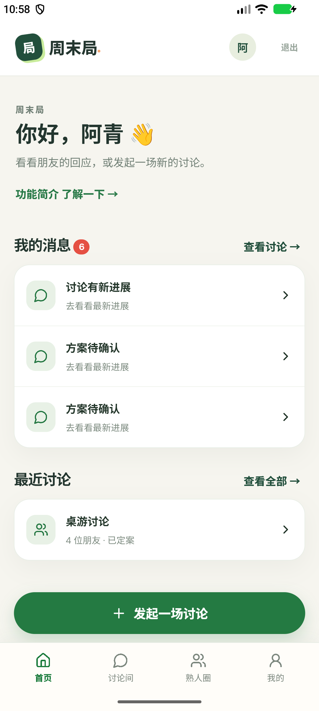
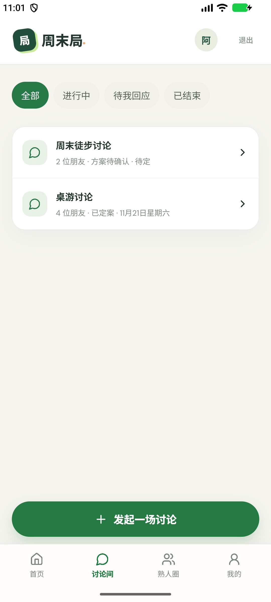
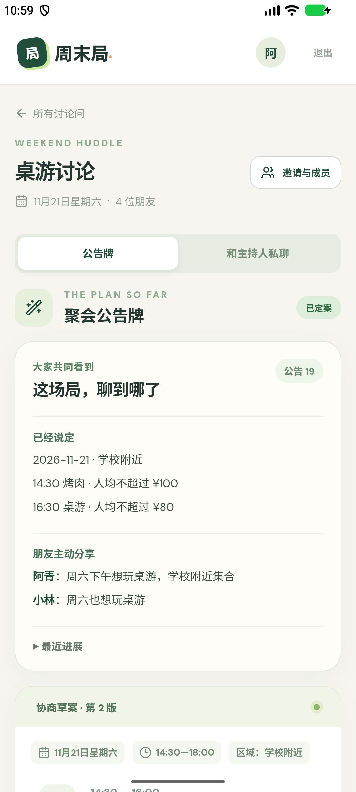

# 周末局 · Weekend Hub


**让熟人之间零散的周末想法，慢慢变成一场真正能成行的活动。**

在朋友群里，大家常说“都可以”，却各有时间、预算和活动偏好。周末局让成员先用自己的话表达想法，帮助小型熟人圈发现共同兴趣；当有人决定发起讨论，AI 再协助整理共识、指出分歧并提出需要商量的问题。是否邀请、是否接受方案、参加哪一项活动，始终由人决定。

> 意愿不是参加承诺；发现共同兴趣不会自动建房；私人原话不会自动进入公共公告。

## 从想法到成行

| 1 · 说出想法 | 2 · 发现机会 | 3 · 一起商量 | 4 · 确认成行 |
| --- | --- | --- | --- |
| “周末想去郊外走走，别太远。” | AI 提取明确条件，提示圈内可能相近的意愿 | 成员自行发起讨论，在共享公告和私人 AI 中补充意见 | 核对当前方案，逐人确认，再按活动分项报名 |

自然语言可以保持模糊。时间、地点或预算暂时没想好，也可以先记录。模型输出会经过后端校验；未表达的条件不会被当成用户承诺。多人出现分歧时，系统可结合已授权的信息提出定向问题和方案建议，方案变更后需要重新确认。

## 产品界面

下面是运行中的 Android 应用截图，使用虚构的示例记录；它们不是设计稿。

<table>
  <tr>
    <td align="center"><br><sub>首页 · 最近讨论与待处理事项</sub></td>
    <td align="center"><br><sub>讨论间 · 进行中与已结束</sub></td>
    <td align="center"><br><sub>共享公告 · 共识、草案与进展</sub></td>
  </tr>
</table>

正式用户使用首页、讨论间、熟人圈和“我的”四个入口。手机 Web 的受邀 Guest 可以通过**限时、限定房间**的链接输入昵称参与当前讨论，之后再关联正式账号；Guest 不能访问熟人圈或其他房间。Web 和 Android 界面支持中英文切换，用户自己写的内容保持原文。

## 我们如何处理 AI 与隐私

- **AI 帮忙理解与协调**：解析意愿、寻找潜在共同兴趣、整理经授权的公开信息、识别诉求差异并生成协调建议。
- **后端负责最终规则**：身份与房间权限、邀请、方案版本、投票、确认和报名由服务端校验并持久化，不能由模型回复直接改写。
- **成员控制公开范围**：私人 AI 会话默认仅本人可读。把私人内容放进共享公告，需要原作者明确授权具体内容。
- **失败有边界**：没有模型服务配置时，部分环节使用规则降级；复杂语义协调依赖开发者自行配置的模型服务。

周末局不提供场所预订，也不会替成员承诺参加。更多设计边界见[产品说明](docs/PRODUCT.md)和[模型与隐私说明](docs/LLM.md)。

## 技术实现

```text
React + Vite Web ─────┐
Capacitor Android ────┼──> Express + TypeScript API ──> SQLite
Taro 微信小程序 ────────┘                └──────────────> 可配置的模型服务
```

三个客户端共用同一后端业务规则。Web 与 Android 复用 React 界面；微信小程序由 Taro 独立实现。后端维护成员权限、讨论状态、异步协调、方案版本及数据持久化。详见[系统架构](docs/ARCHITECTURE.md)。

| 目录 | 内容 |
| --- | --- |
| `server/server/` | Express API、协调逻辑、权限和 SQLite 迁移 |
| `server/src/` | React + Vite Web 界面 |
| `server/android/` | Capacitor Android Studio 工程 |
| `miniprogram/` | Taro + React 微信小程序 |
| `server/tests/` | 单元和集成测试 |

## 本地运行

需要 **Node.js 22+**。进入 `server/` 后安装依赖并复制示例环境文件：

```bash
cd server
npm ci
cp .env.example .env
npm run dev
```

浏览器打开 `http://localhost:3000`。首次启动会在 `server/data/` 创建本地 SQLite 数据库并执行迁移。模型 Key 和服务地址只填写在被 Git 忽略的本地 `.env` 中；仓库不提供公共试用数据库、邀请码或在线服务地址。Android 和微信小程序的构建步骤见[开发指南](docs/DEVELOPMENT.md)。

## 继续阅读

- [产品概念与完整流程](docs/PRODUCT.md)
- [系统架构](docs/ARCHITECTURE.md)
- [数据库与 API](docs/DATABASE_AND_API.md)
- [LLM、降级与隐私](docs/LLM.md)
- [开发与测试](docs/DEVELOPMENT.md)
- [参与贡献](CONTRIBUTING.md) · [安全报告](SECURITY.md) · [变更记录](CHANGELOG.md)

项目采用 [MIT 许可证](LICENSE)。欢迎通过 Issue 和 Pull Request 交流改进。
