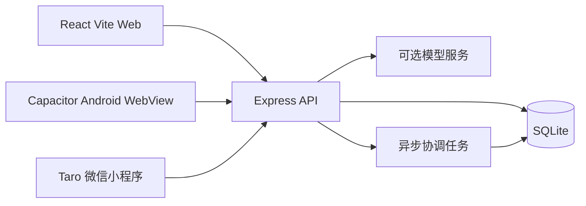

# 系统架构与代码入口

三个客户端共用服务端的权限和业务规则。Web 的 `server/src/api.ts` 用同域 Cookie；Android 复用 Web 构建，可配置 API URL；小程序的 `miniprogram/src/api.ts` 使用 `Taro.request` 与 Bearer Token。Android 是 Capacitor WebView，**不是 Kotlin 原生 UI**。正式微信身份绑定及订阅消息尚未完成。

| 路径 | 作用 |
| --- | --- |
| `server/server/index.ts` | Express 入口、房间/方案/投票/确认/报名路由、CORS 与静态 Web |
| `server/server/community.ts` | 圈子、意愿、候选局和匹配流程 |
| `server/server/auth.ts` / `management.ts` | 会话、账号与圈子成员权限 |
| `server/server/db.ts` | SQLite 打开、迁移和基础查询 |
| `server/server/coordinator.ts` | 草案、版本更新和异步协调 |
| `server/server/bulletin.ts` / `public-summary.ts` | 共享公告和授权内容 |
| `server/server/semantic-coordination.ts` | 模型分析、定向问题和来源校验 |
| `server/src/App.tsx` / `CircleHub.tsx` | Web 主流程和圈子界面 |
| `miniprogram/src/pages/` | 小程序页面；入口在 `app.config.ts` |
| `server/android/` / `server/capacitor.config.ts` | Android 工程和封装配置 |

服务端在请求时核查用户、圈子或房间成员身份。`rooms.current_proposal_id`、`proposals.version`、确认和报名存于 SQLite；异步任务写入前再核对版本或签名，避免旧任务覆盖新方案。单机 SQLite 与内存调度适合项目及小范围试用，不是多实例部署架构。见 [数据与 API](DATABASE_AND_API.md)、[LLM](LLM.md)、[开发指南](DEVELOPMENT.md)。
